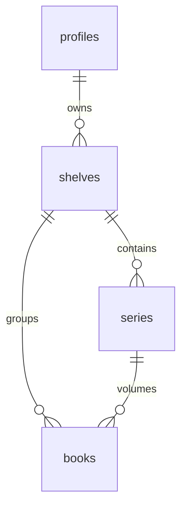

# Shelf Suite — Architecture + Tasks

**Date:** 21 Oct 2026
**Goal:** Sales page ka core promise ("har weekly slot count kare, ek niche me shelf banao") product me sach karna.
**Phase 1 (abhi):** Shelf & Series Manager, Weekly Slot Planner, Royalty & Price Calculator, Mockups + A+ images.
**Phase 2 (baad me):** KDP PDF Checker, Hardcover wrap, Multi-language editions, Ads keyword CSV.

---

## 1. Order aur effort

| Milestone | Kya | Effort (approx) | Depends on |
|---|---|---|---|
| M0 | Foundations: seed persist, shared request parser | 0.5 din | — |
| M1 | Shelf & Series Manager | 3–4 din | M0 |
| M2 | Weekly Slot Planner | 2 din | M1 (shelf priority ke liye) |
| M3 | Royalty & Price Calculator + `suggestedPrice` fix | 1 din | — (kabhi bhi, parallel) |
| M4 | Mockups + A+ images | 2–3 din | M0 |
| M5+ | Phase 2 items | alag-alag | M3 (hardcover pricing) |

M3 sabse chhota aur independent hai, aur sales page vs Launch Kit ka price contradiction (page $9.99 bolta hai, `suggestedPrice()` $6.99–$8.99 deta hai) bhi isi me fix hota hai. Agar warm-up chahiye to M3 se shuru karo.

---

## 2. Existing system jo reuse hoga

- **Book flow:** `create-wizard.tsx` → `POST /api/books` (`assertFeature` + `costFor` + `reserve` + `enqueue`) → `lib/jobs/job-runner.ts` `runJob` → `lib/books/pipeline.ts` `generateAndStoreBook` → `planBook(input).build(seed)`.
- **Seed:** `randomSeed()` har book ko naya seed deta hai, lekin **kahin save nahi hota**. Same seed = byte-identical book (`lib/util/prng.ts`).
- **Grouping pattern:** `bundles` + `books.bundle_id`, `autopilot_runs` + `books.autopilot_run_id`. Series isi pattern pe banegi, lekin bundle reuse nahi hoga (bundle = alag formats, series = same format ke volumes).
- **KDP math:** `lib/pdf/kdp-specs.ts` (`TRIM_SIZES`, `computeCover`, `PAGE_THICKNESS_IN`). Royalty/printing math abhi kahin nahi hai.
- **Rendering:** Puppeteer HTML → PDF/PNG (`lib/pdf/render.ts` `renderPdf`, `renderPng`). Sharp nahi hai, saare images Puppeteer se.
- **Gating:** `lib/billing/plans.ts` (`Feature`, `FEATURE_TIER`, `canUseFeature`), `lib/billing/guard.ts` `assertFeature`, `lib/billing/cost.ts` `costFor`.
- **Launch Kit:** `lib/publishing/package.ts` (`generatePackageData`, `packageFiles`, `buildPackageZip`), price `lib/publishing/metadata.ts` `suggestedPrice`.
- **Nav:** `components/dashboard/nav.tsx` (`PRIMARY`, `MORE` arrays), props `app/dashboard/layout.tsx` se.
- **Migrations:** `supabase/migrations/NNNN_name.sql`, latest `0025_dfy_assets.sql`. `supabase/bootstrap.sql` bhi consolidated schema rakhta hai.
- **Tests:** koi framework nahi. Convention: `scripts/test-*.ts` via `tsx`, npm alias `test:*`. Checks: `npm run typecheck`, `npm run build`.

---

## 3. M0 — Foundations

### 3.1 Seed persist karna
- Migration `0026_book_seed.sql`: `alter table public.books add column seed bigint;`
- `BookGenInput` me `seed?: number` add karo.
- `generateAndStoreBook`: `const seed = input.seed ?? randomSeed()`, `plan.build(seed)`, aur `books.seed` me save.
- Fayda: kisi bhi book ko exactly regenerate kar sakte hain (support/debug), aur series me check kar sakte hain ki naya volume purane seed se alag hai.

### 3.2 Shared request parser
`app/api/books/route.ts` ka validation (type, count clamp, theme required, trim, layout) ek pure function me nikalo:

```ts
// lib/books/request.ts
export function parseBookRequest(body: Record<string, unknown>):
  | { ok: true; bookType: PipelineBookType; input: BookJobInput; displayTitle: string; count: number }
  | { ok: false; status: 400; error: string };
```

`/api/books` aur naya `/api/series/[id]/volumes` dono isi ko use karenge, taaki validation do jagah drift na kare.

### 3.3 Generation opts
`generateAndStoreBook(userId, input, opts)` ke `opts` me add karo: `shelfId`, `seriesId`, `volumeNo`. Insert me `shelf_id`, `series_id`, `volume_no` likho. `job-runner.ts` ke else-branch me `input.shelfId/seriesId/volumeNo/seed/coverStyle` forward karo (abhi sirf `opportunity` jaata hai).

---

## 4. M1 — Shelf & Series Manager

### 4.1 Concept
- **Shelf** = ek niche + audience + pen name (jaise "Brain Games for Seniors"). Isme kisi bhi type ki books ho sakti hain. Sales page ka "shelf" yahi hai.
- **Series** = shelf ke andar ek format ke numbered volumes (jaise "Large Print Garden Word Search Vol. 1, 2, 3"). Same settings, naya seed, consistent title aur cover look.
- Ek book shelf me ho sakti hai bina series ke (one-off), ya shelf + series dono me.



### 4.2 Migration `0027_shelves_series.sql`

```sql
create table public.shelves (
  id uuid primary key default gen_random_uuid(),
  user_id uuid not null references public.profiles(id) on delete cascade,
  name text not null check (char_length(name) between 1 and 120),
  niche text,
  audience text,
  pen_name text,                       -- null = Publishing Profile wala author
  cover_style jsonb not null default '{}'::jsonb,  -- { background, spineColor }
  opportunity jsonb,                   -- Profit Radar se bana ho to
  created_at timestamptz not null default now(),
  updated_at timestamptz not null default now()
);

create table public.series (
  id uuid primary key default gen_random_uuid(),
  user_id uuid not null references public.profiles(id) on delete cascade,
  shelf_id uuid not null references public.shelves(id) on delete cascade,
  name text not null check (char_length(name) between 1 and 160),
  book_type text not null,
  base_input jsonb not null,           -- parseBookRequest ka input, title/seed ke bina
  title_pattern text not null default '{name}, Vol. {n}',
  subthemes text[] not null default '{}',  -- optional, volume-wise variety
  next_volume int not null default 1 check (next_volume >= 1),
  created_at timestamptz not null default now(),
  updated_at timestamptz not null default now()
);

alter table public.books
  add column shelf_id uuid references public.shelves(id) on delete set null,
  add column series_id uuid references public.series(id) on delete set null,
  add column volume_no int check (volume_no is null or volume_no >= 1);

create unique index books_series_volume_uidx
  on public.books (series_id, volume_no)
  where series_id is not null and status <> 'failed';
create index books_shelf_idx on public.books (shelf_id);
create index series_shelf_idx on public.series (shelf_id);

-- RLS: owner-only select/insert/update/delete on shelves + series (user_id = auth.uid()),
-- same pattern as bundles.

-- Atomic volume number allocation (service role only).
create or replace function public.series_take_volume(p_series uuid, p_user uuid)
returns int language plpgsql security definer set search_path = public as $$
declare v int;
begin
  update public.series
     set next_volume = next_volume + 1, updated_at = now()
   where id = p_series and user_id = p_user
  returning next_volume - 1 into v;
  if v is null then raise exception 'series_not_found'; end if;
  return v;
end $$;
revoke all on function public.series_take_volume(uuid, uuid) from public, anon, authenticated;
```

**Volume number decisions:**
- Number enqueue ke time allocate hota hai aur job input me jaata hai, taaki `job_retry` same number reuse kare.
- Job cancel/fail hone pe gap aa sakta hai (Vol. 3 fail, next Vol. 4). User "Generate volume" dialog me number override kar sakta hai. Partial unique index duplicate rokta hai (failed books ko chhod ke).

### 4.3 Pipeline changes
- **Title:** `renderTitle(pattern, { name, n, type })` → `planBook` ko `title` ke roop me jaata hai, isliye AI title skip hota hai, subtitle/description AI se hi aate hain.
- **Author:** `shelf.pen_name ?? profileAuthor(...)` → `input.author`.
- **Subtheme:** agar `series.subthemes` non-empty hai to `theme = base theme + " — " + subthemes[(n-1) % len]`. Isse word lists volume-wise alag rehti hain (sirf grid alag hona kaafi nahi).
- **Cover consistency (as built):** `BookGenInput.coverStyle?: { background?, spineColor?, badge? }`. 12 generators touch karne ki jagah `lib/pdf/cover-style.ts` AsyncLocalStorage use karta hai: pipeline `runWithCoverStyle(style, () => plan.build(seed))` chalata hai aur `buildCoverPdf` `applyCoverStyle()` se style merge karta hai. Generator ka apna color jeet-ta hai. `CoverContent.badge` front panel pe "VOL. 3" chip (escaped, max 24 chars).
- **Launch Kit:** `buildMetadataJson` me `series: { name, number }`, aur `buildChecklist` me line: `[ ] Paperback details me Series add karo: <name>, #<n>`. (KDP series page low-content titles ke liye kaisa behave karta hai, ek baar live verify karna.)

### 4.4 API

| Route | Kaam |
|---|---|
| `GET /api/shelves` | User ke shelves + har shelf ka book count, series count |
| `POST /api/shelves` | `{ name, niche?, audience?, penName?, coverStyle?, opportunity? }` |
| `GET/PATCH/DELETE /api/shelves/[id]` | Detail (series + books), edit, delete (books bachti hain, `shelf_id` null) |
| `POST /api/shelves/[id]/books` | Existing books ko shelf me daalo/nikaalo `{ add: [ids], remove: [ids] }` |
| `POST /api/series` | `{ shelfId, fromBookId }` ya `{ shelfId, name, request }`. `fromBookId` pe `base_input` us book ke `generation_jobs.input` se banta hai (`_cost`, `_action`, `title` strip). Job na mile to `books` columns + `config` se reconstruct. Source book Vol. 1 ban jaati hai. |
| `PATCH/DELETE /api/series/[id]` | Name, title pattern, subthemes edit |
| `POST /api/series/[id]/volumes` | `{ count?: 1..5, volumeNo? }` → har volume: `series_take_volume` → `parseBookRequest(base_input)` → `assertFeature` → `enqueue`. Response `{ jobs: [{ jobId, volumeNo }], failed: [...] }`. Credits khatam ho jaayein to jo queue ho gaye woh rehte hain, baaki `failed` me. |
| `POST /api/series/[id]/subthemes` | AI se 8–12 subthemes suggest (1 credit, `generateJson`) |

Saare routes: `createSupabaseServerClient` se auth, `rateLimit`, ownership check `user_id = user.id`. Mutations admin client se, jaise baaki routes.

### 4.5 Gating aur cost
- `Feature` me `"shelves"` add karo, `FEATURE_TIER.shelves = 1` (yeh FE ka core promise hai).
- Volume ka cost wahi jo us book type ka (`costFor(bookType, { count })`). Shelf/series banane ka cost 0. Subtheme suggestion 1 credit.
- Underlying book type ka gate bhi lagta hai (`assertFeature(user, bookType)`), taaki starter user coloring series na bana sake.

### 4.6 UI
- `app/dashboard/shelves/page.tsx`: shelf cards (spine-style, overview wali bookshelf jaisa look).
- `app/dashboard/shelves/[id]/page.tsx`: series rows, har row me volumes ke spines, "Generate next volume" (count picker + credit cost dikhao), one-off books ka section, "Add existing book".
- `app/dashboard/books/[id]/page.tsx`: "Make this a series" button (shelf choose ya naya banao).
- `create-wizard.tsx`: optional "Add to shelf" select.
- Nav: `PRIMARY` me Book Studio ke baad "Shelves".

---

## 5. M2 — Weekly Slot Planner

### 5.1 Rule
KDP 21 Sept 2026 se har account ko **har format me 2 naye titles per week** deta hai, reset **Sunday 00:00 UTC** (sources: sales-copy doc section 6). Format = paperback, hardcover, ebook alag-alag.

### 5.2 Migration `0028_publications.sql`

```sql
create table public.publications (
  id uuid primary key default gen_random_uuid(),
  user_id uuid not null references public.profiles(id) on delete cascade,
  book_id uuid not null references public.books(id) on delete cascade,
  format text not null check (format in ('paperback','hardcover','ebook')),
  week_start date not null,            -- hamesha Sunday (UTC)
  status text not null default 'planned' check (status in ('planned','published','skipped')),
  published_at timestamptz,
  asin text check (asin is null or asin ~ '^[A-Z0-9]{10}$'),
  notes text,
  created_at timestamptz not null default now(),
  updated_at timestamptz not null default now(),
  unique (book_id, format),
  check (extract(dow from week_start) = 0)
);
create index publications_user_week_idx on public.publications (user_id, week_start, format);
-- RLS owner-only.

alter table public.profiles
  add column weekly_slot_limit int not null default 2 check (weekly_slot_limit between 1 and 20);
```

### 5.3 Logic (`lib/planner/`)
- `week.ts`: `weekStartUtc(date): string` (YYYY-MM-DD, Sunday), `weekRange(start, n)`, `formatForBook(bookType)` (`ebook` → `ebook`, baaki → `paperback`).
- `slots.ts`: `slotUsage(publications, weeks, limit)` → `{ [week]: { [format]: { used, limit, items } } }`.
- `suggest.ts`: `suggestFill(backlog, usage, limit)` pure function. Priority: (1) shelf ki next volume jiska last publish sabse purana hai, (2) shelf books, (3) baaki completed books, oldest first. Yeh sirf suggestion deta hai, likhta kuch nahi.
- Limit check server pe: planned + published count ≥ `weekly_slot_limit` to `409 { code: "SLOT_FULL" }`. Single user ke liye race risk chhota hai, isliye RPC nahi.

### 5.4 API
| Route | Kaam |
|---|---|
| `GET /api/planner?from=YYYY-MM-DD&weeks=6` | Usage grid + backlog (completed books jinki us format ki publication nahi hai) |
| `POST /api/planner` | `{ bookId, format?, weekStart }` (format default `formatForBook`) |
| `PATCH /api/planner/[id]` | Week move, `status: 'published'` + `asin`, notes |
| `DELETE /api/planner/[id]` | Slot free |
| `POST /api/planner/suggest` | `suggestFill` result, user confirm karke apply kare |

### 5.5 UI
- `app/dashboard/planner/page.tsx`: 6 week columns, har week me har format ke 2 slot cells. Cell me book cover thumb (M4 ke baad) ya title. Backlog list side me. "Assign to week" select (drag-drop baad me).
- Week label: "Sun 25 Oct – Sat 31 Oct · resets Sun 00:00 UTC". User ke local timezone me reset time bhi dikhao.
- Overview (`components/dashboard/overview.tsx`) widget: "This week: 1 / 2 paperback slots used".
- Settings: `weekly_slot_limit` field (multiple KDP accounts wale users ke liye).
- Nav: `PRIMARY` me "Planner". Gating `"planner"` tier 1, cost 0.

---

## 6. M3 — Royalty & Price Calculator

### 6.1 Data (`lib/kdp/pricing-data.ts`)
Black ink paperback, cream/white paper, KDP official pages se (Oct 2026 me fetch kiye):

| Marketplace | Currency | 60% at ≥ | Fixed regular (24–110 pp) | Fixed large (24–110 pp) | 110+ pp regular | 110+ pp large |
|---|---|---|---|---|---|---|
| amazon.com | USD | 9.99 | 2.30 | 2.84 | 1.00 + 0.012/pg | 1.00 + 0.017/pg |
| amazon.ca | CAD | 13.99 | 2.99 | 3.53 | 1.26 + 0.016/pg | 1.26 + 0.021/pg |
| amazon.co.uk | GBP | 7.99 | 1.93 | 2.15 | 0.85 + 0.010/pg | 0.85 + 0.012/pg |
| amazon.de/fr/it/es/nl/ie/com.be | EUR | 9.99 | 2.05 | 2.48 | 0.75 + 0.012/pg | 0.75 + 0.016/pg |
| amazon.pl | PLN | 40 | 9.58 | 11.61 | 3.51 + 0.056/pg | 3.51 + 0.075/pg |
| amazon.se | SEK | 110 | 22.84 | 27.67 | 8.37 + 0.134/pg | 8.37 + 0.179/pg |
| amazon.com.au | AUD | 13.99 | 4.74 (24–108) | 5.28 (24–108) | 2.42 + 0.022/pg | 2.42 + 0.027/pg |
| amazon.co.jp | JPY | 1000 | 422 | 530 | 206 + 2/pg | 206 + 3/pg |

- Large trim = width > 6.12" ya height > 9".
- Fixed-only band ke upar formula poore page count pe lagta hai: `fixed + pages × perPage` (KDP example: 333 pp regular US = 1.00 + 333 × 0.012 ≈ $5.00).
- Royalty: `rate × listPrice − printingCost`. Expanded Distribution: 40% (alag toggle).
- Max list price bhi data me rakho (USD 250, CAD 350, EUR 250, GBP 250, AUD 350, JPY 30000, PLN 1200, SEK 2500).
- Sources: [KDP Printing Cost](https://kdp.amazon.com/en_US/help/topic/G201834340), [KDP Paperback Royalty](https://kdp.amazon.com/en_US/help/topic/G201834330). Har quarter re-verify karna. File ke top pe `VERIFIED_AT` constant rakho.
- Color ink, groundwood aur hardcover tables Phase 2 me isi file me add honge.

### 6.2 Functions (`lib/kdp/royalty.ts`, pure, no I/O)
```ts
isLargeTrim(trim: TrimSize): boolean
printingCost(mkt: MarketplaceId, trim: TrimSize, pages: number): number
royaltyRate(mkt: MarketplaceId, listPrice: number): 0.5 | 0.6
royalty(mkt, trim, pages, listPrice, opts?: { expanded?: boolean }): number
minListPrice(mkt, trim, pages): number      // cost / 0.5; agar woh 50% band se bahar jaaye to max(cost / 0.6, threshold60)
recommendPrice(mkt, trim, pages): { price: number; royalty: number; reason: string }
```
- `recommendPrice` default: us marketplace ka 60% threshold price (jaise $9.99, £7.99, €9.99), agar `minListPrice` usse kam hai. Warna `minListPrice` ke upar next `.99`.
- Rounding: currency ke decimals ke hisaab se (JPY 0 decimals). Money ko cents/integer me compute karo, floats me nahi.

### 6.3 Integration
- `suggestedPrice()` (`lib/publishing/metadata.ts`) ko replace karo: print books ke liye `recommendPrice("com", trim, pageCount).price`. Ebook ke liye abhi wala 4.99 rehne do (Kindle royalty alag model hai). `profiles.default_price` override wahi rahe.
- `metadata_json` me `pricing: { [mkt]: { listPrice, printingCost, royalty, rate } }`.
- Launch Kit me nayi file `pricing.txt`: har marketplace ka recommended price + royalty, aur ek line agar user ka override price 50% band me hai ("$8.99 pe ~$1.66, $9.99 pe ~$3.15").
- UI: `app/dashboard/royalty/page.tsx` standalone calculator (trim, pages, marketplace, price slider, 50/60 boundary highlight). Book detail page pe chhota "Royalty" card jo book ke trim + pages se prefilled ho.
- Nav: `MORE` me "Royalty Calculator". Gating `"royalty_calculator"` tier 1, cost 0. Calculator client-side bhi chal sakta hai kyunki pure function hai, API ki zaroorat nahi.

### 6.4 Sales copy check
Implement ke baad sales page section 04/19 ke numbers ($9.99 → ≈ $3.15, $7.99 → ≈ $1.16, $8.99 → ≈ $1.66) is function se cross-check karo.

---

## 7. M4 — Mockups + A+ images

### 7.1 Problem
Per-book cover sirf PDF ke roop me store hota hai, aur repo me PDF ko PNG banane ka tool nahi hai. Isliye mockups ke liye generation ke time hi PNG previews save karne honge.

### 7.2 Pipeline me previews (best-effort)
- `buildCoverPdf` aur `buildInteriorPdf` (`lib/pdf/index.ts`) apne result me `html` bhi return karein.
- `generateAndStoreBook` upload ke baad:
  - `cover-wrap.png` (150 DPI, `renderPng(cover.html, { widthIn: fullWidthIn, heightIn: fullHeightIn })`).
  - 3 interior pages `preview-1..3.png`: ek normal puzzle page, ek beech ka, ek answer key. Naya helper `renderPagePng(html, spec, pageIndex)` (`lib/pdf/render.ts`) jo baaki pages CSS se hide karke screenshot le. Pehle `templates/interior.ts` ka page wrapper class confirm karo.
  - Keys `books.assets` jsonb me: `{ coverPng, previews: [...] }`.
  - Yeh step fail ho to book fail nahi hogi. Sirf log karo.
- Purani books (feature se pehle bani) ke liye previews nahi honge. UI me "Regenerate previews" tabhi possible hai jab cover content dobara mile, jo abhi store nahi hota. v1 me sirf nayi books + Cover Studio PNG wali books support karo. Baad me zaroorat ho to `pdfjs-dist` se rasterize (nayi dependency, pinned version).

### 7.3 Migration `0029_book_assets.sql`
```sql
alter table public.books add column assets jsonb not null default '{}'::jsonb;
```
Shape: `{ coverPng?, previews?: string[], mockups?: { [kind]: key }, mockupsAt? }`.

### 7.4 Mockup engine (`lib/mockups/`)
- `templates/*.ts`: har kind ek HTML function. Cover PNG data URI ke roop me embed hota hai. Front panel aur spine CSS `background-position` se crop hote hain (offsets `computeCover(trim, pageCount)` se). CSS 3D transforms + shadows, network nahi.
- `render.ts`: `renderMockup(kind, inputs)` → `renderPng` exact pixel size pe (`widthIn = px / 96`, `dpi = 96`).
- Kinds (v1):

| Kind | Size | Use |
|---|---|---|
| `paperback_3d` | 1600×1600 | Listing/social, transparent ya soft background |
| `look_inside` | 2000×1250 | Khuli book, 2 preview pages |
| `shelf_stack` | 1600×1000 | Series ke volumes ek saath (M1 se jude) |
| `social_square` | 1080×1080 | Instagram/Pinterest |
| `aplus_header` | 970×600 | A+ header: cover + title + 3 bullets |
| `aplus_tile_1..4` | 300×300 | A+ four-image module: previews + captions |

- A+ module sizes KDP A+ Content Manager me ship se pehle verify karna, kyunki Amazon kabhi-kabhi badalta hai.
- A+ text (bullets, captions): `book_metadata.description` + Launch Kit se ek `generateJson` call. Fallback template text.
- Output storage `${userId}/${bookId}/mockups/${kind}.png`.

### 7.5 API, gating, UI
- `POST /api/books/[id]/mockups` `{ kinds?: MockupKind[] }`: sync render (`maxDuration` 60), keys `books.assets.mockups` me. `GET /api/books/[id]/mockups/zip` saari PNGs ka ZIP (JSZip).
- Launch Kit ZIP me `mockups/` folder agar bani hui hain.
- Feature `"mockups"`, `FEATURE_TIER.mockups = 2`, plus entitlement `mockups` taaki OTO bhi unlock kar sake (`canUseFeature` already `entitlements[feature] === true` handle karta hai). Cost `costFor("mockups") = 1` per pack.
- UI: book detail page pe "Mockups" tab: grid, download single/ZIP, regenerate.

---

## 8. Phase 2 (short architecture)

### 8.1 KDP PDF Checker
- `lib/pdf/validate.ts` `validateBook` file paths leta hai. Ek `validateBookBytes({ interior?, cover?, trim, paper, bleed })` variant banao.
- Upload: Supabase signed upload URL → `uploads/${userId}/${uuid}.pdf`, size cap 100 MB, 24h baad delete.
- Checks: page count ≥ 24, uniform page size = trim (+ bleed), fonts embedded, cover single page, cover size vs `computeCover`, gutter guess (text bbox ka v2 me). Report: pass/warn/fail list, KDP language me.
- `"pdf_checker"` tier 1, cost 0. Yeh "pass KDP first time" bonus ke saath achha jaata hai.

### 8.2 Hardcover wrap
- `computeHardcoverCover({ trim, pageCount, paper })` `kdp-specs.ts` me. Wrap, hinge, allowed trims aur page range KDP hardcover help page se le ke daalna; abhi repo me koi data nahi hai.
- Hardcover printing cost table `pricing-data.ts` me. `publications.format = 'hardcover'` already planner me hai.
- `wrap-pdf` route me `binding=hardcover` param.

### 8.3 Multi-language editions
- `BookGenInput.language` (`en | es | de | fr | it` se start).
- Thread karna: AI word-list prompt, `sanitize` (`lib/ai/word-list.ts` abhi A–Z ke alawa sab hata deta hai, isliye per-language alphabet chahiye, jaise ÄÖÜ/ß, ÉÈ, Ñ), word banks, interior fixed strings (`lib/i18n/strings.ts`), metadata + Launch Kit prompts.
- Grid me ß jaise letters ka decision: uppercase variant ya exclude.
- Launch Kit me marketplace mapping (de → amazon.de) + `recommendPrice` us marketplace ka.

### 8.4 Ads keyword CSV
- Launch Kit me `ads_keywords.csv`: `keyword, match_type, suggested_bid_note`. Primary 7 (exact + phrase) + long-tail 20 (broad).
- Amazon Ads bulksheet format baad me. v1 ka goal sirf copy-paste ready list hai.

---

## 9. Tasks

Har task ke baad: `npm run typecheck`. Har milestone ke end me: `npm run build` + uske `scripts/test-*.ts`.

### M0 — Foundations
- [x] **M0.1** Migration `0026_book_seed.sql` (`books.seed bigint`) + `bootstrap.sql`. (`DATABASE_SCHEMA.md` pehle se outdated hai, bundles/autopilot bhi nahi hain, isliye touch nahi kiya.)
- [x] **M0.2** `BookGenInput.seed` + `normalizeSeed`, `generateAndStoreBook` me `normalizeSeed(input.seed) ?? randomSeed()` + save. File: `lib/books/pipeline.ts`.
- [x] **M0.3** `lib/books/request.ts` `parseBookRequest`. `app/api/books/route.ts` usse use karta hai. (Manual smoke har type ki ek book abhi baaki hai.)
- [x] **M0.4** `generateAndStoreBook` opts me `shelfId`, `seriesId`, `volumeNo` (sirf set hone pe insert hote hain). `job-runner.ts` else-branch `seed`, `author`, shelf/series/volume forward karta hai.
- **Done when:** existing books pehle jaise ban rahi hain, aur naye `books` rows me `seed` bhara hai.

### M1 — Shelf & Series
- [x] **M1.1** Migration `0027_shelves_series.sql` (tables, indexes, owner-select RLS, `series_take_volume(series, user, volume?)`) + `bootstrap.sql`.
- [x] **M1.2** `lib/shelves/core.ts` (pure helpers), `store.ts` (data access), `http.ts` (route plumbing).
- [x] **M1.3** `Feature` + `FEATURE_TIER.shelves = 1`.
- [x] **M1.4** `CoverContent.badge` + `BookGenInput.coverStyle` via `lib/pdf/cover-style.ts` (generators untouched).
- [x] **M1.5** Routes: `/api/shelves`, `/api/shelves/[id]`, `/api/shelves/[id]/books`. `/api/books` optional `shelfId` bhi leta hai.
- [x] **M1.6** Routes: `/api/series`, `/api/series/[id]`, `/api/series/[id]/volumes`, `/api/series/[id]/subthemes`.
- [x] **M1.7** Launch Kit: `metadata_json.series` + checklist line.
- [x] **M1.8** UI: `/dashboard/shelves`, `/dashboard/shelves/[id]`, book detail "Make this a series", wizard `?shelf=` deep link, nav "Shelves".
- [x] **M1.9** `scripts/test-shelves.ts` (`npm run test:shelves`, 12 checks).
- [x] **M1.10** Live end-to-end: migrations applied, sudoku series Vol. 2–4 generate hue (alag seeds, VOL badge).
- [x] **M1.11** Pen name gate: koi book "BookNexa" author ke saath nahi banti. Routes `409 PEN_NAME_REQUIRED` dete hain, UI ek baar `PenNameDialog` dikhata hai aur `/api/settings/pen-name` se profile me save karta hai.
- **Done when:** ek word search book se series bana ke Vol. 2 aur Vol. 3 generate ho, titles "…, Vol. 2/3" hon, cover pe badge + same colors hon, seeds alag hon, aur Launch Kit me series info ho.

### M2 — Weekly Slot Planner
- [x] **M2.1** Migration `0028_publications.sql` + `profiles.weekly_slot_limit` + `bootstrap.sql`.
- [x] **M2.2** `lib/planner/core.ts` (week math, slot counting, backlog order, `suggestFill`) + `lib/planner/store.ts` (data access).
- [x] **M2.3** `scripts/test-planner.ts` (`npm run test:planner`, 7 checks incl. Sat 23:59 vs Sun 00:00 UTC aur IST timezone).
- [x] **M2.4** Routes `/api/planner` (GET grid, POST single/batch), `/api/planner/[id]` (move, status, ASIN, notes, delete), `/api/planner/suggest`, `/api/planner/settings`.
- [x] **M2.5** `/dashboard/planner` (6-week grid, backlog, "Fill my free slots", slots-per-week select), overview strip, nav (More → Slot Planner; PRIMARY bar me jagah nahi thi). Alag Feature key nahi, sab tiers ke liye open.
- **Done when:** ek week me 3rd paperback slot 409 de, ebook slot alag count ho, "Mark published" ASIN save kare, aur overview widget sahi count dikhaye.

### M3 — Royalty & Price
- [x] **M3.1** `lib/kdp/pricing-data.ts` (8 marketplace rows, `VERIFIED_AT = 2026-10-21`).
- [x] **M3.2** `lib/kdp/royalty.ts` (integer micro-unit math; `printingCost`, `royaltyRate`, `royalty`, `minListPrice`, `recommendPrice`, `recommendAll`, `formatMoney`).
- [x] **M3.3** `scripts/test-royalty.ts` (`npm run test:royalty`, 12 checks incl. KDP ka 333pp example, AU 108pp band, JPY).
- [x] **M3.4** `suggestedPrice(bookType, pages, trim)` ab royalty engine se, `metadata_json.pricing`, Launch Kit me `pricing.txt` (50%-band override warning ke saath), checklist line update.
- [x] **M3.5** `/dashboard/royalty` page, book detail pe compact "Pricing & royalty" card, nav (More → Royalty Calculator). Calculator client-side pure hai, isliye alag Feature key nahi banayi (sab tiers ke liye open).
- [x] **M3.6** Sales page numbers ($9.99 → 3.15, $8.99 → 1.66, $7.99 → 1.16, $11.99 → 4.35) tests me match.
- **Done when:** test script pass, aur nayi Launch Kit 8.5×11 puzzle book ke liye $9.99 suggest kare.

### M4 — Mockups + A+
- [x] **M4.1** Migration `0029_book_assets.sql` + `bootstrap.sql`.
- [x] **M4.2** `lib/pdf/index.ts` results me `html`; `renderPagePngs` (ek load, kai pages) in `lib/pdf/render.ts`.
- [x] **M4.3** Pipeline me best-effort cover wrap PNG (150 DPI) + 3 previews (page 4–5 spread + back page), `books.assets` update.
- [x] **M4.4** `lib/mockups/` — `kinds.ts`, `templates.ts` (9 kinds: 3D paperback, look inside, series stack, social square, A+ header 970×600, A+ banner 970×300, 3× A+ tile 300×300), `render.ts`, `source.ts`, `assets.ts`.
- [x] **M4.5** `scripts/test-mockups.ts` (`npm run test:mockups`, 12 checks, exact sizes + A+ < 2 MB, PNGs `output/mockups-test/` me).
- [x] **M4.6** Routes `POST /api/books/[id]/mockups`, `GET /api/books/[id]/mockups/[kind|zip]`. Launch Kit ZIP me `mockups/`.
- [x] **M4.7** Feature `"mockups"` (**tier abhi 1, FE vs OTO OPEN**), `costFor("mockups") = 1`. Book detail pe "Mockups & A+ images" panel.
- [x] **M4.8** A+ ko KDP ke official "A+ Content Examples" page ke hisaab se kiya: saari A+ images 2× (banner 1940×600, tiles 600×600, header 1940×1200), max 3 MB, naya text-free banner (`aplus_banner_clean`, KDP overlay box ke liye), tiles ke caption bade + bold.
- [ ] **M4.9** Live: `0029` apply → nayi book banao → mockups render → Launch Kit ZIP me `mockups/`.
- **Done when:** nayi book ke liye 6 PNGs exact sizes me banein, ZIP download ho, aur `shelf_stack` series ke saare volumes dikhaye.

### M5+ — Phase 2
- [ ] **M5** PDF Checker (section 8.1).
- [ ] **M6** Hardcover (8.2), M3 data ke baad.
- [ ] **M7** Multi-language (8.3), `es` + `de` se start.
- [ ] **M8** Ads CSV (8.4), sabse chhota, kabhi bhi.

---

## 10. Open decisions

1. **Mockups FE me ya OTO? (OPEN)** Abhi `FEATURE_TIER.mockups = 1` (sab plans). OTO me le jaana ho to `lib/billing/plans.ts` me tier badhao; koi offer `mockups` entitlement se bhi unlock kar sakta hai.
2. **Shelf naming:** UI me "Shelf" (sales copy se match), DB me `shelves`/`series`. Theek hai?
3. **Series multi-volume limit:** ek click me max 5 volumes. Agency users ke liye zyada?
4. **Purani books ke mockups:** v1 me skip, ya abhi `pdfjs-dist` add karein?
5. **Planner drag-drop:** v1 me select dropdown. Drag-drop ke liye nayi library chahiye hogi.
